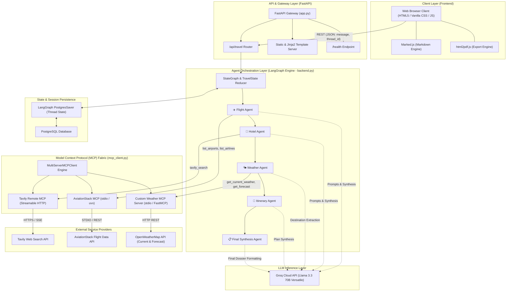
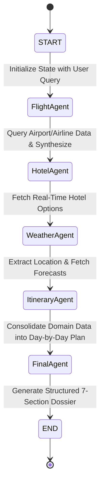
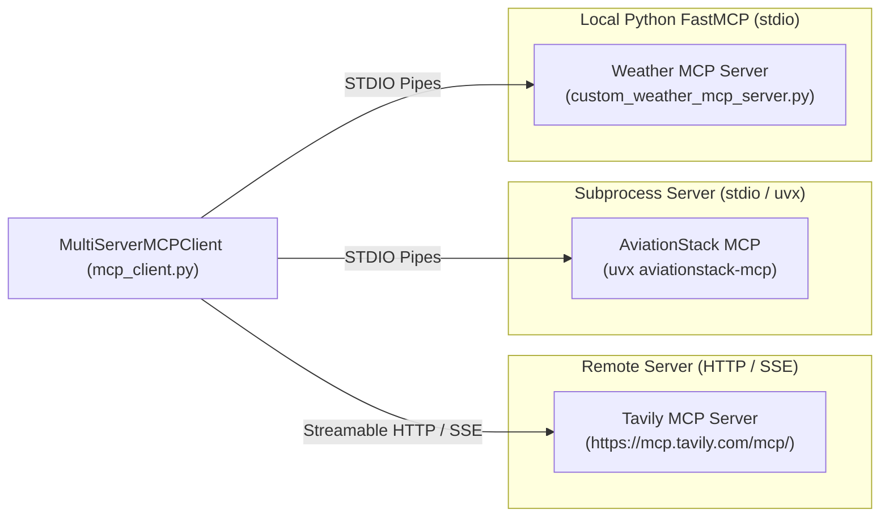
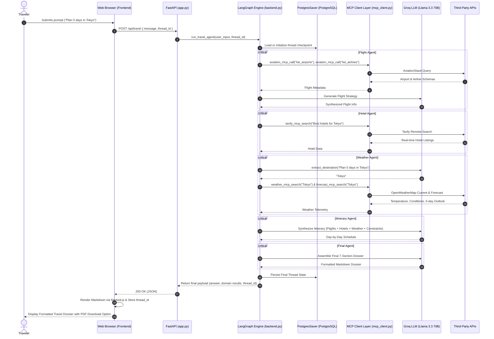
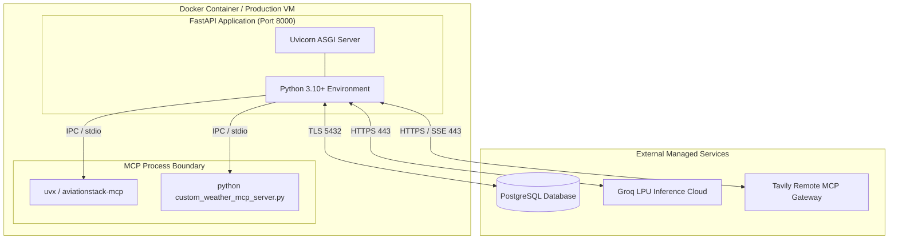

# 🏛️ High-Level Design (HLD) — TripMate AI

## 1. Document Control & Executive Summary

| Attribute | Details |
| :--- | :--- |
| **System Name** | TripMate AI (Multi-Agent Travel Planner) |
| **Document Version** | 1.0.0 |
| **Status** | Approved / Living Document |
| **Primary Architecture** | Agentic Workflow (DAG) with Model Context Protocol (MCP) |
| **Orchestration Framework** | LangGraph & LangChain Core |
| **Serving Framework** | FastAPI (ASGI / Uvicorn) |
| **State Persistence** | PostgreSQL Checkpointer (`PostgresSaver`) |
| **LLM Provider** | Groq (`llama-3.3-70b-versatile`) |

### Executive Summary
TripMate AI is an autonomous, multi-agent travel planning system designed to eliminate the friction of fragmented travel booking and itinerary generation. By coordinating specialized cognitive agents across distinct operational domains (flights, hotels, weather, and scheduling), TripMate AI constructs comprehensive, hyper-personalized, and budget-conscious travel itineraries from a single natural-language user prompt. 

The application implements modern distributed tool connectivity via the **Model Context Protocol (MCP)**, combining remote HTTP MCP servers, local CLI-spawned MCP servers, and custom in-process micro-servers into a unified agentic ecosystem.

---

## 2. High-Level System Architecture

The following diagram illustrates the overarching system boundary, communication boundaries, and interactions across client, backend, agent graph, MCP tooling layer, and third-party APIs.



---

## 3. Core Architectural Layers & Components

### 3.1. Client Presentation Layer
* **Technology**: Vanilla HTML5, CSS3 (Glassmorphism design language with dynamic background circles), JavaScript (ES6+).
* **Key Capabilities**:
  * Single-Page Interface with asynchronous payload submission via `fetch`.
  * Real-time loading indicators and thread ID preservation via `localStorage`.
  * Dynamic client-side Markdown rendering via `Marked.js`.
  * Export-to-PDF utility via `html2pdf.js` with print-optimized CSS layout.
  * Quick-prompt recommendation buttons for fast-start workflows.

### 3.2. API Gateway & Hosting Layer (`app.py`)
* **Framework**: FastAPI (Asynchronous Server Gateway Interface - ASGI).
* **Server**: Uvicorn running on Python 3.10+.
* **Concurrency**: Integrated with `nest_asyncio` to allow nested asynchronous event loops when invoking asynchronous LangGraph workflows synchronously from route handlers.
* **Endpoints**:
  * `GET /`: Serves the Jinja2 rendered HTML application view.
  * `POST /api/travel`: Primary operational entry point. Validates request structure (`TravelRequest` Pydantic model), triggers graph execution, and streams back final synthesized markdown plus raw domain artifacts.
  * `GET /health`: Liveness probe verifying server health.

### 3.3. Multi-Agent Orchestration Layer (`backend.py`)
Built on LangGraph, replacing monolithic prompts with a sequential, deterministic Directed Acyclic Graph (DAG) that enforces specialized single-responsibility principles across autonomous agents.



#### Graph State Specification (`TravelState`)
The blackboard pattern is utilized where each node reads from and mutates a centralized, typed state container:

```python
class TravelState(TypedDict):
    messages: Annotated[list[AnyMessage], operator.add]  # Accumulative dialogue stream
    user_query: str                                      # Raw traveler prompt
    flight_results: str                                  # Domain-specific flight insights
    hotel_results: str                                   # Curated hotel recommendations
    weather_results: str                                 # Current conditions and 5-period forecast
    itinerary: str                                       # Structured day-by-day schedule
    llm_calls: int                                       # Execution telemetry / counter
```

#### Node Roles & Responsibilities

| Node Name | Input State Dependencies | Primary Functionality | Tools / Interfaces |
| :--- | :--- | :--- | :--- |
| **`flight_agent`** | `user_query` | Evaluates origin and target hubs, queries airport databases and airline routes, and estimates airfare ranges. | `aviation_mcp_call` (`list_airports`, `list_airlines`) + Groq LLM |
| **`hotel_agent`** | `user_query` | Formulates targeted hotel search strings, filters live web search results for location, quality, and price. | `tavily_mcp_search` via Remote MCP |
| **`weather_agent`** | `user_query` | Extracts destination entity using LLM, queries both current conditions and 5-period forecasts. | `extract_destination` + `weather_mcp_search` + `forecast_mcp_search` |
| **`itinerary_agent`** | `user_query`, `flight_results`, `hotel_results`, `weather_results` | Synthesizes logistics, stays, and weather conditions into an actionable, chronologically sequential itinerary. | Groq LLM (`llama-3.3-70b-versatile`) |
| **`final_agent`** | All state artifacts | Formats the combined data into a 7-section travel dossier with price disclosures and safety advisories. | Groq LLM (`llama-3.3-70b-versatile`) |

---

## 4. Model Context Protocol (MCP) Fabric

The Model Context Protocol (MCP) standardizes how LLM applications connect to external tools, data sources, and runtime environments. TripMate AI implements a multi-protocol, multi-server topology orchestrated via `langchain-mcp-adapters.client.MultiServerMCPClient`.



### 4.1. Server Connection Profiles

| Server Key | Transport Type | Launch Strategy / URL | Authentication | Primary Provided Tools |
| :--- | :--- | :--- | :--- | :--- |
| `tavily` | `streamable_http` | `https://mcp.tavily.com/mcp/?tavilyApiKey=...` | API Key in Query Parameters | `tavily_search` |
| `aviationstack` | `stdio` | `uvx aviationstack-mcp` (isolated runtime) | Subprocess environment variable (`AVIATION_STACK_API_KEY`) | `list_airports`, `list_airlines`, `search_flights` |
| `weather` | `stdio` | `python custom_weather_mcp_server.py` | Subprocess environment variable (`OPENWEATHER_API_KEY`) | `get_current_weather`, `get_forecast` |

### 4.2. Fault-Tolerant Initialization
* In earlier monolithic setups, failure of any single tool (e.g. rate-limited flight API or missing `uvx`) would abort initialization of all tools.
* TripMate AI utilizes isolated lazy-loading methods (`initialize_mcp()`, `initialize_aviation_tools()`, `initialize_weather_tools()`). If one provider encounters transient errors, other nodes proceed and provide partial responses with explicit disclosures.

---

## 5. End-to-End Execution Sequence

The sequence diagram below details the chronological request lifecycle from user input to rendered travel itinerary:



---

## 6. Persistence & State Checkpointing

Session persistence is maintained using LangGraph's native PostgreSQL checkpointing mechanism:
* **Checkpointer**: `langgraph.checkpoint.postgres.PostgresSaver`.
* **Connection Lifecycle**: Established via `psycopg` connection pools configured with `autocommit=True` and `dict_row` factories.
* **Thread Partitioning**: Every conversation session is uniquely identified by `thread_id` (e.g. `user_a1b2c3d4...`). If not provided by the client, a UUID4 string is assigned and returned for subsequent interactions.
* **Resilience**: Enables multi-turn contextual continuity, error auditing, and potential human-in-the-loop (HITL) checkpoints.

```
+------------------------------------------------------------+
|                    PostgreSQL Database                     |
+------------------------------------------------------------+
| - checkpoints           : Graph state snapshots per node   |
| - checkpoint_blobs      : Serialized memory & state values |
| - checkpoint_writes     : Ephemeral channel updates        |
+------------------------------------------------------------+
```

---

## 7. Data Contracts & API Specifications

### 7.1. Travel Request Payload (`POST /api/travel`)
```json
{
  "message": "Plan a 4-day trip to Singapore with family under $1500",
  "thread_id": "user_4a78c187f5494cbdbcbdf74092b70f08"
}
```

### 7.2. Travel Response Payload
```json
{
  "success": true,
  "thread_id": "user_4a78c187f5494cbdbcbdf74092b70f08",
  "answer": "# ✈️ 4-Day Family Trip to Singapore\n\n### 1. Trip Summary\n...",
  "flight_results": "Departure: DAC / Arrival: SIN...",
  "hotel_results": "1. Marina Bay Sands...\n2. Hotel Jen...",
  "itinerary": "Day 1: Arrival & Marina Bay...\nDay 2: Sentosa Island...",
  "llm_calls": 4
}
```

### 7.3. Standardized Output Sections
The final response delivered to the client guarantees adherence to seven structured sections:
1. **Trip Summary**: Purpose, length, budget parameters, and climate overview.
2. **Flight Information**: Departure/arrival recommendations, transit carriers, typical durations, and estimated airfare ranges.
3. **Hotel Suggestions**: Curated accommodations with price-tier categorizations.
4. **Weather Information**: Current weather readings and 5-period forecast summary.
5. **Day-by-Day Itinerary**: Chronological morning/afternoon/evening schedule with route-optimized attractions.
6. **Estimated Budget**: Domain breakdowns (transit, lodging, food, activities) against requested constraints.
7. **Final Recommendations**: Visa notices, local cultural norms, transit cards, and packing guidance.

---

## 8. Non-Functional Requirements & System Qualities

### 8.1. Scalability & Performance
* **LLM Latency**: Powered by Groq's LPUs running Llama 3.3 70B, maintaining average inference speeds of 250-350 tokens/sec.
* **Subprocess Isolation**: MCP tool servers run in isolated processes or over HTTP, preventing memory leaks in the primary ASGI process.
* **Stateless API Tier**: FastAPI instances are completely stateless; all conversation checkpoints are offloaded to PostgreSQL, enabling horizontal auto-scaling behind an Nginx or cloud load balancer.

### 8.2. Resiliency & Graceful Degradation
* **External API Failures**: All MCP calls are wrapped in robust exception handlers. If AviationStack, Tavily, or OpenWeather encounters quota limits or timeouts, the orchestrator logs the exception and informs the LLM to supply estimated heuristic guidance with a disclaimer.
* **SSL Validation**: Explicitly loads system CA certificates via `certifi` (`SSL_CERT_FILE` and `REQUESTS_CA_BUNDLE`) to eliminate corporate firewall or proxy handshake failures.

### 8.3. Security & Governance
* **Zero Hardcoded Secrets**: All credentials (`GROQ_API_KEY`, `TAVILY_API_KEY`, `AVIATIONSTACK_API_KEY`, `OPENWEATHER_API_KEY`, `DATABASE_URL`) are read via strictly managed environment variables (`python-dotenv`).
* **Safe Input Sanitization**: User inputs are stripped and validated via Pydantic; markdown output is sanitized and rendered via standard client libraries.

---

## 9. Deployment Architecture

The system is containerized for production deployment across container platforms (Docker, Kubernetes, Render, Railway, AWS ECS):



### Docker Container Specification
* **Base Image**: `python:3.10-slim`
* **System Utilities**: `git`, `curl`
* **Command**: `uvicorn app:app --host 0.0.0.0 --port 8000`

---

## 10. Future Architectural Roadmap

1. **Streaming Responses (SSE)**: Transition `POST /api/travel` to a Server-Sent Events (SSE) stream to display per-agent status updates in real time on the frontend.
2. **Interactive Map Visualizations**: Integrate Leaflet.js or Mapbox on the frontend to visualize flight routes, hotel locations, and itinerary stops on an interactive map.
3. **Budget Negotiation & Flight Booking**: Connect live flight search APIs (e.g. Amadeus or Duffel) via dedicated transactional MCP servers.
4. **Human-in-the-Loop (HITL)**: Introduce LangGraph approval breakpoints before finalizing itineraries with booked reservations.
